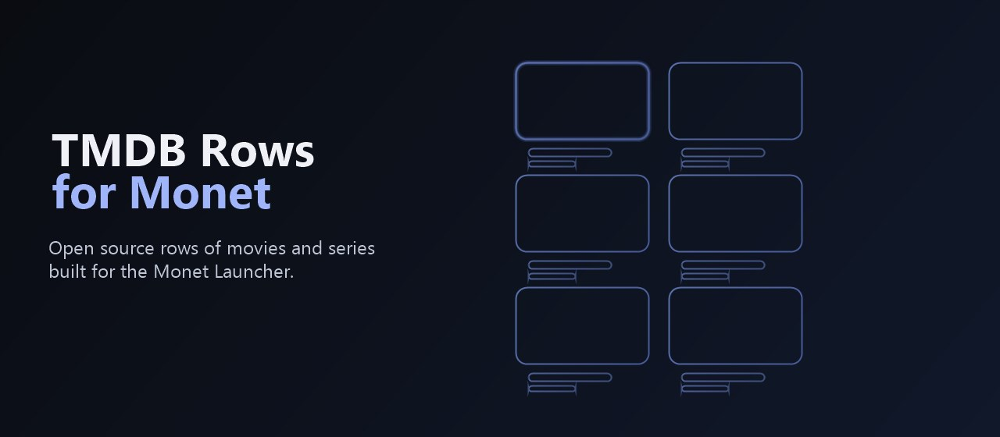
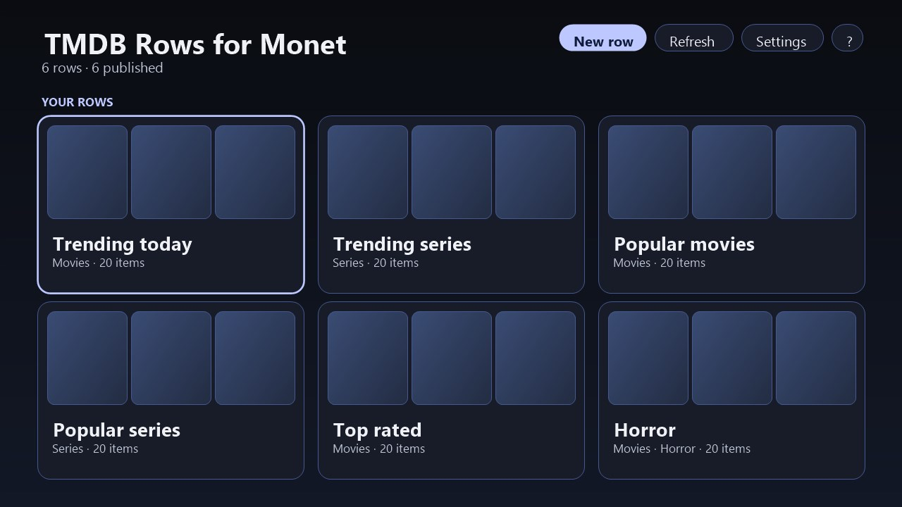
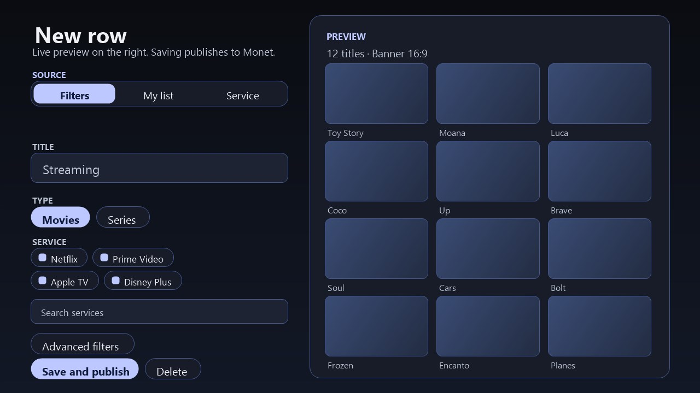
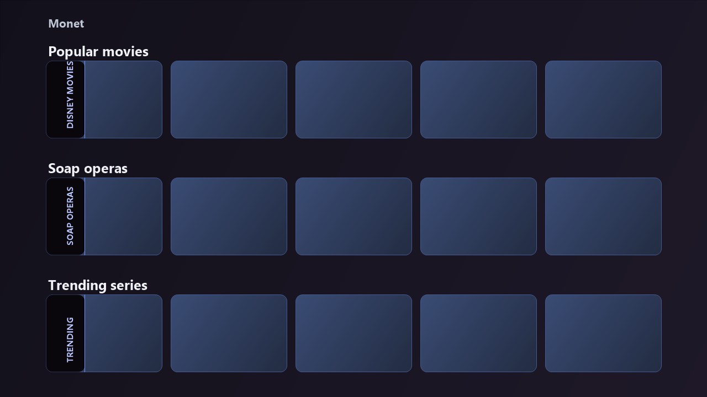
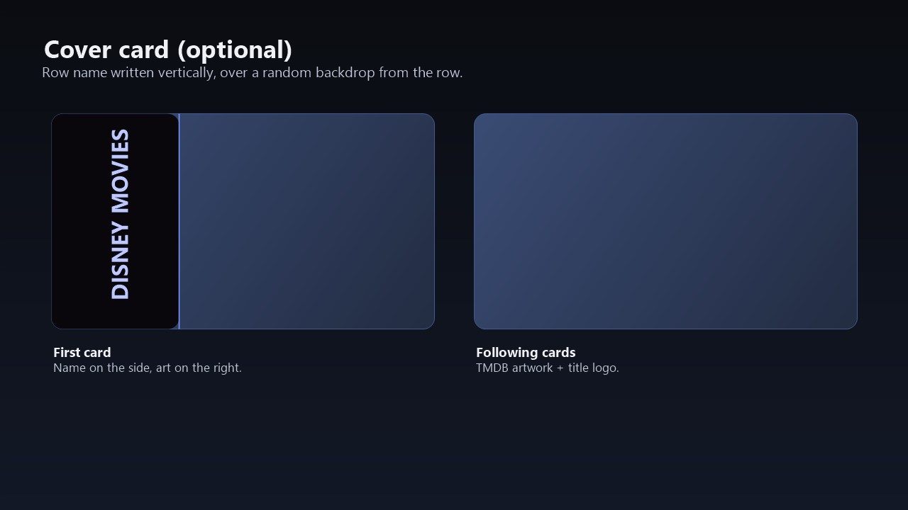

# TMDB Rows for Monet

Um **plugin para o Monet Launcher**: transforma o TMDB em linhas de filmes e séries.
Código aberto (MIT). É só isso que faz — sem player, sem launcher.



| | |
| --- | --- |
| **Início da app** — as tuas linhas | **Editor** — cria uma linha |
|  |  |
| **No Monet** — linhas prontas a ver | **O primeiro cartão é a capa** |
|  |  |
| **A carregar** | |
|  | |

## Como funciona

1. Instala o APK e cola a tua chave gratuita do [TMDB](https://www.themoviedb.org/settings/api).
2. Cria uma linha: filtros do TMDB, **Minha lista** (IDs ou pesquisa) ou uma **plataforma de
   streaming**.
3. **Salvar e publicar** e adiciona no **Monet → Personalizar → linha de mídia → TMDB Rows for
   Monet → o nome da linha**.

Guia completo: [Português](docs/tutorial.pt-BR.md) · [English](docs/tutorial.md).

## Linhas

- **Filtros do TMDB** — em alta, populares, melhor avaliados, em cartaz, no ar, novas séries, descobrir.
- **Minha lista** — IDs ou links do TMDB, ou pesquisa pelo nome.
- **Plataforma de streaming** — as principais, com um campo de pesquisa para o resto da lista, mais
  **Hoje na TV** e **Novas séries** para a plataforma escolhida.
- **Por linha** — um cartão de capa opcional com o nome da linha, ordem (incluindo aleatório), arte
  (banner 16:9 ou póster 2:3, com capas BetterPosters opcionais) e player (Nuvio/Stremio).
- **Cartões** — compostos no aparelho: backdrop, logo do título e etiquetas (nota, ano, gênero, NOVO)
  no idioma escolhido.

## Instalar

Descarrega o `tmdb-rows-for-monet-*.apk` das [Releases](../../releases) e instala numa Android TV
(8.0+):

```bash
adb install -r tmdb-rows-for-monet-1.0.apk
```

## Compilar

```bash
./gradlew :app:assembleRelease   # ~1,6 MB, R8
./gradlew :app:testDebugUnitTest
```

Assinatura: `release.keystore` + `keystore.properties` (fora do Git); sem eles a release usa a chave
de debug. Guarda a keystore — os APKs futuros têm de manter a mesma assinatura.

## Notas

- Desenvolvido e testado com o **Monet**; os cartões abrem no **Nuvio** ou no **Stremio**.
- Tudo fica no aparelho; a chave só é enviada para `api.themoviedb.org`.
- Até 50 itens por linha.

## Licença

[MIT](LICENSE). Usa a API do TMDB; não é endossado nem certificado pelo TMDB.
